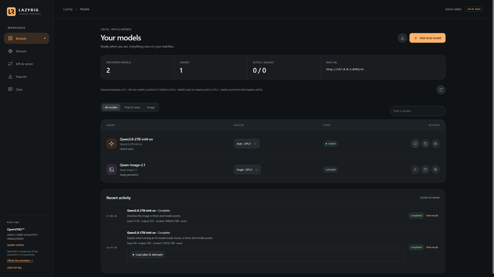

# LazyRig Server

**Local chat, vision and image generation in one browser workspace.**

**v0.41 beta** · Built on OpenVINO™ GenAI · [Apache 2.0](LICENSE)

LazyRig runs compatible AI models on your computer. Chat with a language model,
ask questions about pictures, generate and edit images, or connect another
application through an OpenAI-compatible API subset. Manage your models and
choose their devices from the same interface.

[Download v0.41 beta](https://github.com/lazyrig/lazyrig-server/releases/tag/v0.41beta)
· [Step-by-step setup with screenshots](docs/GETTING-STARTED.md)
· [Connect a client](docs/CONNECTING.md)

*Actual v0.41 beta interface. Models are downloaded separately.*

## What you can do

- **Chat and use vision:** write to a local model or attach images and ask questions.
- **Generate and edit images:** use an image model directly, or let a compatible
  chat model call it and continue the conversation with the result.
- **Manage models:** register local OpenVINO exports, import supported models
  from Hugging Face, select devices and control when models stay loaded.
- **Connect your tools:** use the documented chat and image API endpoints.

## Start on Windows

1. Download **`LazyRig_Server_v0.41beta.zip`** from the
   [release assets](https://github.com/lazyrig/lazyrig-server/releases/tag/v0.41beta).
2. **Extract the whole ZIP** into a writable folder, then open `lazyrig-server`.
3. Double-click **`start-server.bat`**. The first run prepares Python and installs
   dependencies; leave the console open.
4. Open **http://127.0.0.1:8765** in your browser when the server is ready.
5. Choose **Models → Add local model**, select a compatible OpenVINO export folder,
   inspect it and register it. Then open **Chat**, choose the model and send a message.

No model yet? **Imports** can download existing OpenVINO exports or convert
supported source models. Follow the [illustrated guide](docs/GETTING-STARTED.md)
for both routes and your first text, vision and image requests.

Initial setup and model downloads need internet. Model weights and GPU drivers
are separate. Keep the console open while using LazyRig; press **Ctrl+C** there
to stop the server. [Windows installation help](docs/WINDOWS-SETUP.md).

**Linux:** setup scripts are included. See the
[Linux instructions](docs/GETTING-STARTED.md#linux) for Python 3.12/3.13 and driver requirements.

## Hardware scope

**Intel GPUs are the supported graphics target. CPU support follows the installed
OpenVINO CPU plugin, regardless of vendor.** You need enough memory for the
chosen model and its working data. Hands-on testing has been on Intel hardware;
compatibility depends on the model export, runtime and driver.

Other detected accelerators are experimental. This release has no NVIDIA CUDA
or AMD GPU backend. See [device and memory settings](docs/MODEL-SETTINGS.md).

## Connect another application

Use **`http://127.0.0.1:8765/v1`** as the base URL and your registered **API model
alias** as the model name. If authentication is enabled, use the matching API key.
See [client setup](docs/CONNECTING.md) and the [API reference](docs/API.md).

## Documentation

| I want to… | Guide |
| --- | --- |
| Install and try chat, vision and images | [Getting started](docs/GETTING-STARTED.md) |
| Troubleshoot Windows setup | [Windows setup](docs/WINDOWS-SETUP.md) |
| Configure devices, memory, context or MTP | [Model settings](docs/MODEL-SETTINGS.md) |
| Change image sizes, steps or editing options | [Image settings](docs/IMAGE-SETTINGS.md) |
| Enable optional prompt enhancement | [Prompt enhancement](docs/PROMPT-ENHANCEMENT.md) |
| Connect a client or configure network access | [Connections](docs/CONNECTING.md) |
| Build an integration | [API reference](docs/API.md) |
| Update the inference runtime | [Runtime updates](docs/RUNTIME-UPDATES.md) |
| Upgrade, roll back or understand beta limits | [Beta guide](docs/BETA-TEST.md) |

## Current limits

This is a **beta for trusted local use**. Image editing uses one source image.
Multi-device splitting is experimental. Work sharing a device runs serially;
a server restart interrupts unfinished inference. The API supports a documented
subset of OpenAI endpoints, and there is no isolation between users' jobs or files.
See [known limits](docs/BETA-TEST.md#current-limits) before using advanced workflows.

[Report a problem](https://github.com/lazyrig/lazyrig-server/issues) with your device,
model/export, runtime and driver versions, and the steps that reproduce it.

## Data and upgrades

Conversations are stored in your browser; jobs, generated files and settings are
stored on the server. Back them up separately. For an existing installation,
follow [upgrade and rollback instructions](docs/BETA-TEST.md#safe-setup-with-an-existing-installation).

## License and acknowledgements

Copyright 2026 LazyRig contributors. LazyRig's original code and documentation
are [Apache-2.0](LICENSE).
Models are not bundled and retain their own licenses; see
[model licenses](docs/MODEL-LICENSES.md) and [third-party notices](THIRD_PARTY_NOTICES.md).

LazyRig is an independent project and is not affiliated with or endorsed by Intel.
OpenVINO is a trademark of Intel Corporation or its subsidiaries.
