# Getting started with LazyRig

**From a fresh download to your first local conversation.**

Complete steps **1–3** to start chatting. Vision, image generation and connecting
another application are optional. These are real **v0.41 beta** screenshots;
your model names, device numbers and results will depend on your setup.

The examples use **Qwen3.8-27B-int4-ov** for chat and vision and **Qwen-Image-2.1**
for image generation. They demonstrate one working setup, not minimum requirements
or a promise that every export works. Models and GPU drivers are not bundled.

[Install](#1-install-and-start) · [Add a model](#2-add-your-first-model) ·
[Chat](#3-send-your-first-message) · [Vision](#4-ask-about-an-image) ·
[Generate images](#5-generate-an-image) · [Edit images](#6-edit-an-image) ·
[Connect a client](#7-connect-another-application)

## 1. Install and start

### Windows

1. Download **`LazyRig_Server_v0.41beta.zip`** from the
   [v0.41 beta release assets](https://github.com/lazyrig/lazyrig-server/releases/tag/v0.41beta).
   Choose this named application download.
2. Use **Extract All**, then open the extracted **`lazyrig-server`** folder.
   Keep all its files together in a writable location, such as `C:\LazyRig`.
3. Double-click **`start-server.bat`**. On the first run, it prepares the application
   environment and installs dependencies. This needs internet and may take time.
4. Leave the console open and visit **http://127.0.0.1:8765** when the address appears.

You do not need to install Python manually for the normal Windows setup. The
launcher uses a compatible environment or prepares a private Python runtime.
The browser does not open automatically. An empty model list is expected.

On later starts, use the same `start-server.bat`. Press **Ctrl+C** in its console
to stop LazyRig. For installer choices and repairs, see [Windows setup](WINDOWS-SETUP.md).
If upgrading an existing installation, follow the [beta upgrade guide](BETA-TEST.md#safe-setup-with-an-existing-installation).

### Linux

Extract the same ZIP. Use a supported Linux installation with standard 64-bit
Python **3.12 or 3.13** and the appropriate device drivers. From `lazyrig-server`:

```sh
chmod +x setup.sh start-server.sh
./setup.sh
./start-server.sh
```

Linux setup installs dependencies into a local environment; it does not install
Python or GPU drivers. Later starts only need `./start-server.sh`. Open
**http://127.0.0.1:8765** and stop the server with **Ctrl+C**.

**Ready:** the top right of the dashboard says **Server online**.

## 2. Add your first model

Start with a compatible language model, or a **vision-language model (VLM)** if
you also want to ask questions about images. A smaller compatible model can be
a better first choice if your available memory is limited.

### Use an OpenVINO export already on your computer

1. Open **Models → Add local model**.
2. Enter or browse to the model's **export folder**, then select **Inspect folder**.
   Choose the folder containing the complete export, not an individual XML/BIN file.
3. Check the detected pipeline. Choose a unique **API model alias**, display name
   and device. Use a context limit supported by the model and your memory.
4. Select **Register model**.

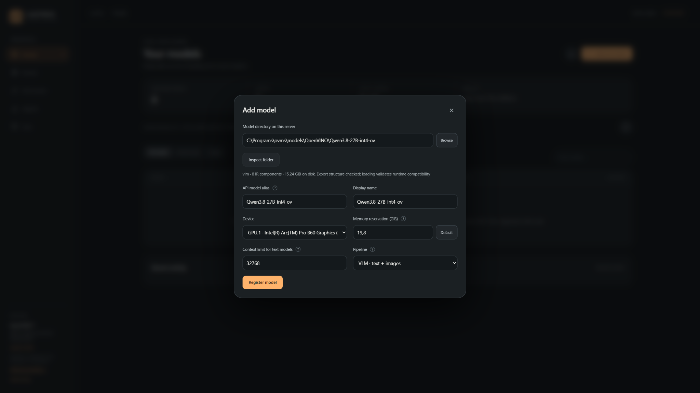

The screenshot's path and alias are examples. Use your own folder; the Windows
account running LazyRig must be able to read it. **Browse** shows folders on the
server computer. Folder inspection checks the export's structure; loading checks
runtime compatibility.

Start with one suitable Intel GPU, or CPU. The prefilled **Memory reservation**
is a scheduling estimate based on the device budget, not measured model usage.
Lowering this number does not make a large model fit. For budgets, shared memory,
additional devices and context/cache settings, see [Model settings](MODEL-SETTINGS.md).

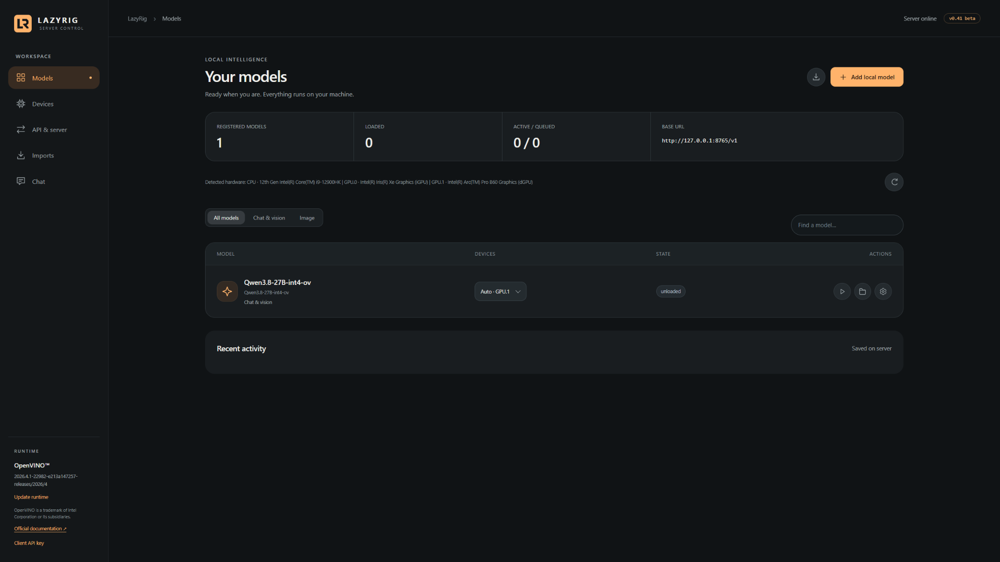

**Unloaded is normal:** the model is registered and will load when first used.
You can also use its **Load** button to check loading explicitly.

<details>
<summary>No local export yet? Download or convert a supported model</summary>

1. Open **Imports**, or use the download icon on **Models**.
2. Paste the Hugging Face repository URL into **Source URL** and choose a new or
   empty output folder on the server computer.
3. Use **Automatic · convert if needed**, or **Download existing exports only**
   for a repository that already contains a compatible OpenVINO export.
4. Keep **Register automatically when ready** enabled, choose an alias and device,
   and select **Download and prepare model**.

Wait for completion in Imports. Conversion may install a separate environment
and take longer than downloading a ready export. Not every model architecture
or checkpoint format is supported; choosing INT4 does not requantize an existing export.

Review the model's license and terms before downloading. For gated repositories,
the URL importer has no authenticated Hugging Face token flow: obtain permitted
access separately, download a compatible export and register its folder.
See [Model licenses](MODEL-LICENSES.md).

</details>

## 3. Send your first message

1. Open **Chat** and use **+** beside **Conversations** to start a new conversation.
2. Select your model at the top and leave the task at **Chat & vision**.
3. Enter a short prompt and press **Enter**, or click the orange send arrow.
   **Shift+Enter** adds a new line.

For example:

> Explain what running an AI model locally means, in three short bullet points.

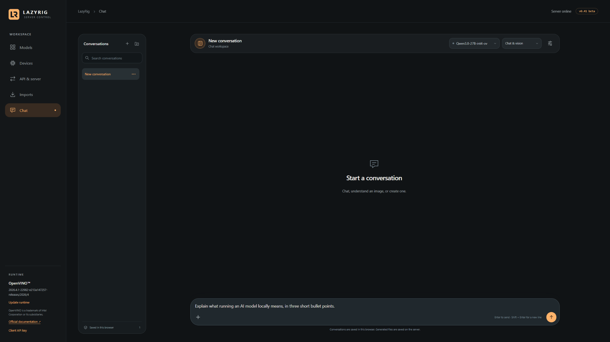

The first request may take longer while the model loads and compiles. Wait for
the response; the send button becomes a stop control while work is running.

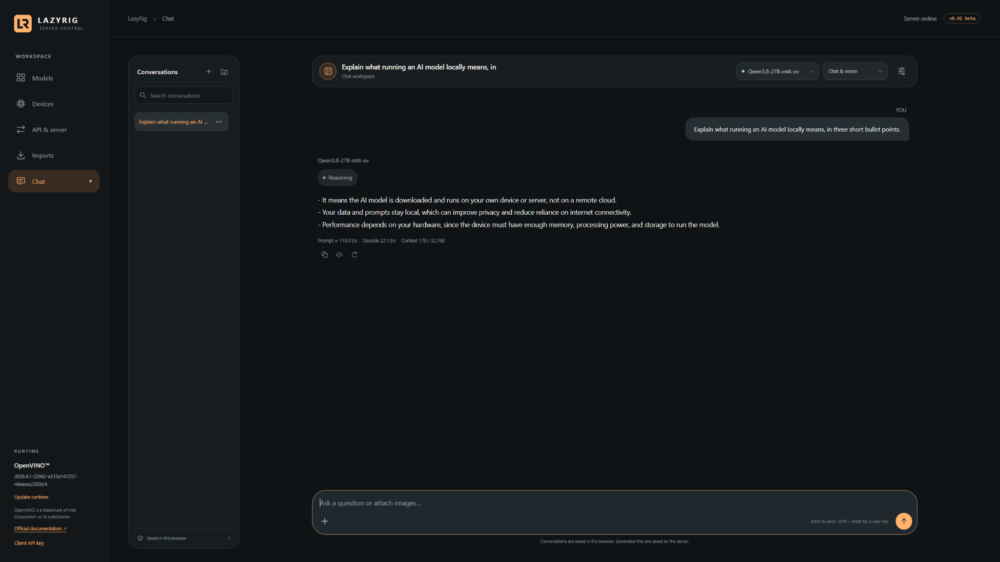

**You can now use LazyRig for text chat.**

The sliders icon at the top right opens **Conversation settings**. Leave the
defaults for your first request. These settings apply to this conversation;
the gear beside a model on **Models** changes that model's saved defaults.

Conversations appear in the left panel. Use the folder-plus button to create a
folder, drag conversations into it, or use a conversation's **…** menu to move,
export or delete it. New chats go into the selected folder while it is
open. Scroll upward to read older messages; return to the bottom to resume following.

## 4. Ask about an image

Use a **vision-capable model** under **Chat & vision**:

1. Start a new conversation, then use the **+** in the message box to attach an image.
2. Write your question and send it. For example:

> Describe this image in three short bullet points.

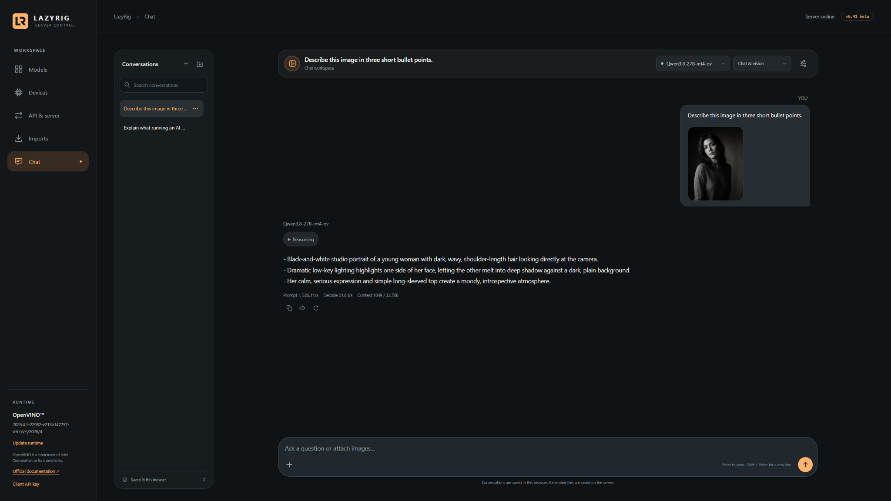

The same VLM handles text and image questions. Vision chat can accept multiple
images within the [input limits](API.md#vision-input). Image editing, below,
uses one source image per edit.

## 5. Generate an image

You need a separate, compatible **image model**. Register its complete OpenVINO
export through **Models → Add local model**, as you did for the chat model.
The example uses **Qwen-Image-2.1** and the **Image generation** pipeline.

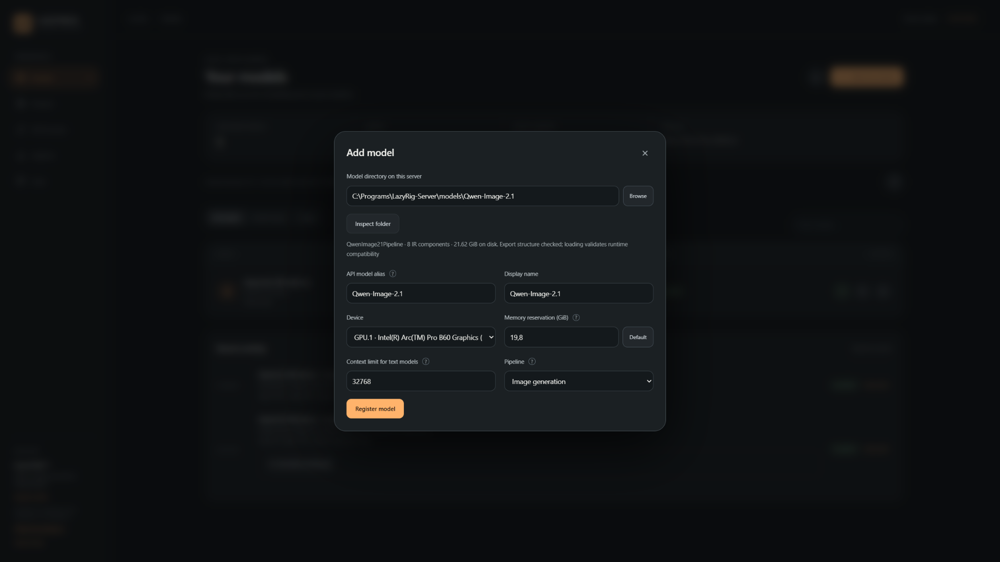

### Let the chat model call the image tool

This route needs a chat model whose export and chat template support tool calling.

1. Start a new **Chat & vision** conversation with your chat/VLM model selected.
2. Check that the **Image tool** chip is enabled in the message box. Open the
   sliders icon and select your image model under **Image tool** if needed.
   New conversations automatically select an available default image tool.
3. Leave image size and generation settings at their model defaults for your
   first attempt. Optional prompt enhancement can stay off.
4. Send an image request. The example uses:

> A small wooden cabin beside a still mountain lake at sunrise, photorealistic, soft natural light.

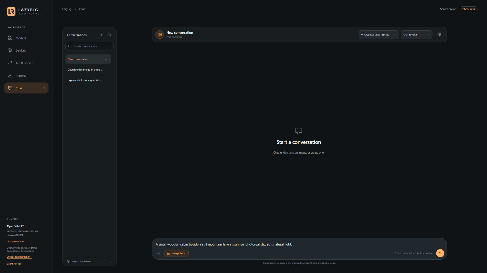

The chat model asks the image model to generate the picture. The selected model
at the top remains your **chat model**; the image tool runs the separate image
model. When they share a device, LazyRig may unload one to make room for the other.

<details>
<summary>What happens while the image is being generated?</summary>

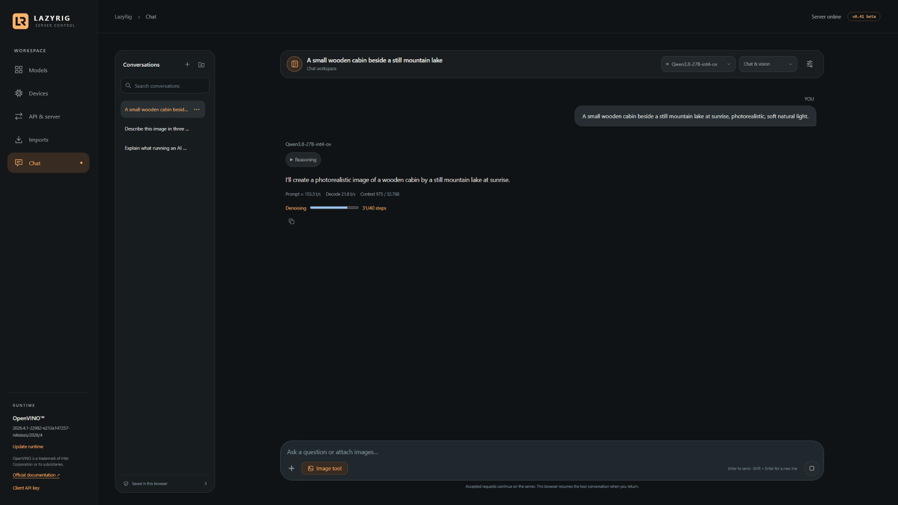

The conversation shows loading or generation progress. After the image is saved,
the chat model can load again and continue its answer. This can take time when
models share a GPU. The progress capture shows an intermediate step, not a
completed job. Memory and retention behavior is explained in
[Model settings](MODEL-SETTINGS.md#image-memory-retention).

</details>

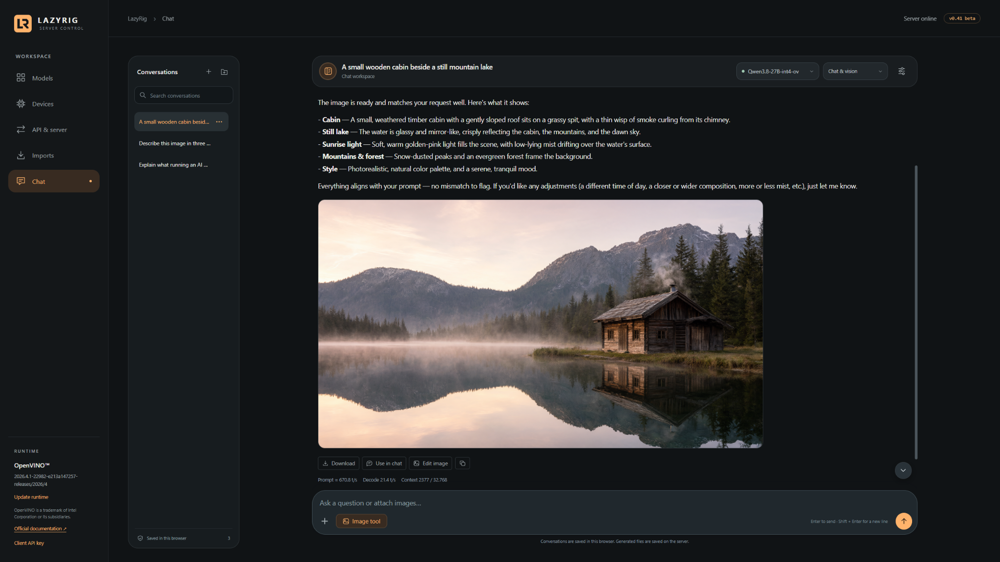

Use **Download** below the result to save it. **Use in chat** selects it as a
source for a follow-up request; **Edit image** opens direct editing.

If the chat model only describes an image without producing one, check the
image-tool selection and the model's tool-calling support.

<details>
<summary>Generate directly, without a chat model</summary>

Start a new conversation, change the task selector from **Chat & vision** to
**Generate image**, select your image model and send a prompt. The sliders icon
opens settings such as image size and steps. This route does not need a VLM or
a tool call. See [Image settings](IMAGE-SETTINGS.md).

</details>

## 6. Edit an image

With a compatible editing model registered, click **Use in chat** below a result
or attach one source image. Keep the image tool enabled and ask, for example:

> Change it to nighttime.

A compatible chat model can call the edit tool and continue with the result.
Alternatively, choose the **Edit image** task directly, select the image model,
attach one source and describe the change. The result's **Edit image** button
opens that direct workflow for you.

The example continues from the cabin image above:

<details>
<summary>See the edit request and progress</summary>

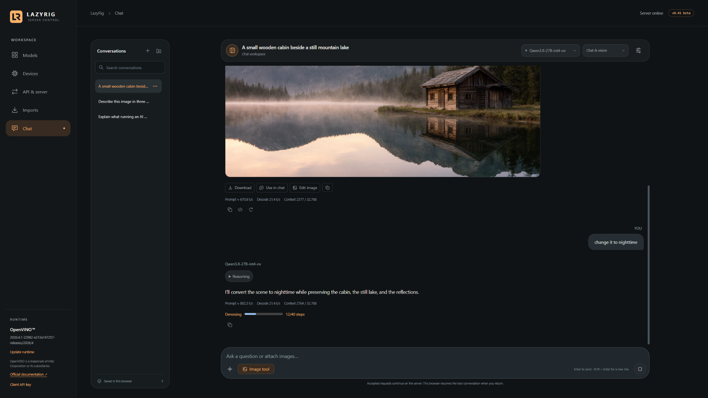

</details>

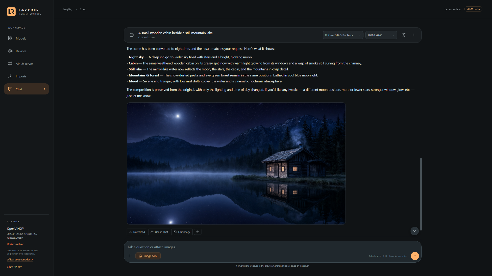

The final screenshot shows the nighttime edit and the chat model's follow-up.
The conversation panel is collapsed to give the image more room.

Each edit accepts **one source image**. Masks and multi-source edits are not
supported. Keep the original for comparison: completing a job does not guarantee
that every requested visual change succeeded. This example shows a returned
nighttime edit; broader editing quality depends on the model/export/settings.
See [Image settings](IMAGE-SETTINGS.md) for the full controls and limitations.

## 7. Connect another application

Open **API & server** for the endpoint and copyable request examples.

| Client setting | Default local value |
| --- | --- |
| OpenAI-compatible base URL | `http://127.0.0.1:8765/v1` |
| Model name | Your **API model alias**, such as `Qwen3.8-27B-int4-ov` in these screenshots |
| API key | The matching server key, if authentication is enabled |

Some clients require a nonempty key field even without authentication. The API
implements a [documented subset](API.md), so compatibility depends on the endpoints
and options the client uses. For Hermes, browser frontends, authentication and
access from another computer, follow [Connections](CONNECTING.md).

## Save your work and come back

Conversations and their attachments live in this browser's IndexedDB. Use
**… → Export conversation** for a copy. Jobs, generated files and settings live
in the server's data directory, usually `server-data/`; model folders can be elsewhere.

Closing the browser leaves the server running. An accepted background job can
continue, but later conversation/tool stages wait for the browser to return.
Stopping or restarting the server interrupts unfinished inference. Saved results
remain available. Changing browser or server address can show a different chat history.

For upgrades and backups, follow the [beta guide](BETA-TEST.md).

## If something does not work

| Symptom | First check |
| --- | --- |
| Setup failed or a dependency is missing | Read the console and `logs/setup-*.log`; follow [Windows setup](WINDOWS-SETUP.md) |
| Dashboard disconnected | Keep the server console running and use its printed address |
| Model folder inaccessible | Use a folder readable by the Windows account running the server |
| Model does not load | Expand **Models → Recent activity → Load plan & attempts** and read the error |
| Model exceeds the device budget | Check device capacity, model size and reservation; a lower reservation does not reduce actual memory use |
| No image result from chat | Check **Image tool**, image-model registration and chat tool-calling support |
| Request appears slow | Check loading/generation progress and Recent activity before submitting it again |

Bug reports should include the LazyRig version, device, runtime/driver versions,
model/export and steps to reproduce the issue. Remove keys and private content
from shared logs. [Current beta limits](BETA-TEST.md#current-limits).

[README](../README.md) · [Model settings](MODEL-SETTINGS.md) ·
[Image settings](IMAGE-SETTINGS.md) · [Runtime updates](RUNTIME-UPDATES.md) · [API](API.md)
